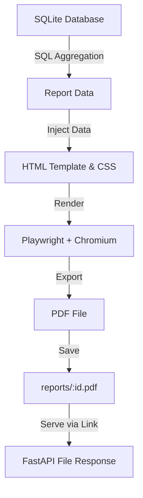

# PDF Report Generator

A lightweight, production-ready FastAPI application that generates professional PDF sales reports from SQLite data.

The project demonstrates a clean report pipeline:

**Query → Render → Store → Serve**

The PDF is generated as a file on disk, while the API returns a link to that file instead of passing raw PDF bytes through JSON responses.

---

## Tech Stack

- **Language:** Python 3.10+
- **API Framework:** FastAPI
- **Database:** SQLite
- **Headless Browser / Rendering:** Playwright (Chromium)
- **ASGI Server:** Uvicorn

---

## Project Structure

```text
pdf-report-generator/
├── main.py              # FastAPI app, routing, and idempotency logic
├── seed.py              # Database seeding script (200 sample orders)
├── report_queries.py    # Analytical SQL queries for report data
├── pdf_generator.py     # HTML template & Playwright PDF rendering engine
├── .gitignore           # Git ignore rules for DB, venv, and outputs
├── report.db            # Generated locally, ignored by Git
├── reports/             # Generated PDFs directory, ignored by Git
└── venv/                # Python virtual environment
```

---

## Features

- **SQLite Database:** Pre-populated with 200 sample orders across multiple products and dates.
- **Idempotent Database Reseeding:** Cleanly wipes and reseeds exactly 200 randomized records.
- **SQL Aggregation Queries:**
  - Total orders calculation
  - Total revenue calculation
  - Top 5 products ranked by revenue
  - Daily order velocity for the last 7 days
- **Professional Multi-page PDF Report:**
  - Clean page breaks avoiding split rows
  - Repeating table headers across page breaks
- **FastAPI Report Endpoints:**
  - On-demand PDF generation
  - PDF files persisted to disk
  - Direct file download via secure link
  - Standardized 404 error handling for missing reports
- **Idempotency Protection:** Prevents duplicate report generation for same-day requests.
- **Forced Regeneration:** Optional bypass flag to force generating a new report when needed.

---

## Setup

### 1. Create and Activate Virtual Environment

```powershell
python -m venv venv
.\venv\Scripts\Activate.ps1
```

*(On Linux / macOS: `source venv/bin/activate`)*

### 2. Install Dependencies

```bash
pip install fastapi uvicorn playwright
```

### 3. Install Chromium for Playwright

```bash
playwright install chromium
```

---

## Seed the Database

Populate `report.db` with sample data:

```bash
python seed.py
```

The seed script clears existing orders before inserting fresh records:
- **200 orders**
- **6 products** (`Laptop`, `Keyboard`, `Mouse`, `Monitor`, `Headphones`, `Webcam`)
- Random order amounts between $5 and $200
- Order dates spanning the last 30 days

> [!NOTE]
> Running the seed script multiple times keeps the database at exactly 200 orders.

---

## Run the API

Start the FastAPI development server:

```bash
uvicorn main:app --reload
```

The API will be accessible at: `http://localhost:8000`

### Health Check

```bash
curl.exe http://localhost:8000/health
```

**Expected Response:**

```json
{
  "status": "ok"
}
```

---

## Aggregation Queries

The report metrics are computed directly from SQLite using SQL aggregations:

### Total Orders
```sql
SELECT COUNT(*)
FROM orders;
```

### Total Revenue
```sql
SELECT COALESCE(SUM(amount), 0)
FROM orders;
```

### Top 5 Products by Revenue
```sql
SELECT
    product,
    ROUND(SUM(amount), 2) AS revenue
FROM orders
GROUP BY product
ORDER BY revenue DESC
LIMIT 5;
```

### Orders Per Day for the Last 7 Days
```sql
SELECT
    created_at,
    COUNT(*) AS orders
FROM orders
WHERE created_at >= date('now', '-6 days')
GROUP BY created_at
ORDER BY created_at;
```

---

## API Usage & Examples

### 1. Generate a Report

Send a `POST` request to generate today's report:

```bash
curl.exe -i -X POST http://localhost:8000/reports
```

The first request generates the PDF and returns the report ID and download URL:

```json
{
  "id": 5,
  "file": "/reports/5/file"
}
```

The generated PDF is stored on disk inside the `reports/` directory.

---

### 2. View Report Metadata

Retrieve information about a specific report:

```bash
curl.exe http://localhost:8000/reports/5
```

**Example Response:**

```json
{
  "id": 5,
  "path": "reports\\5.pdf",
  "created_at": "2026-10-01T19:34:06.123456"
}
```

---

### 3. Download the PDF

Open the returned file link in a browser or download via `curl`:

```text
http://localhost:8000/reports/5/file
```

```bash
curl.exe -O http://localhost:8000/reports/5/file
```

The endpoint serves the generated PDF directly from disk using `FileResponse`. Only the file endpoint transfers binary PDF bytes, keeping all other API endpoints fast and lightweight.

---

## Duplicate Requests & Idempotency

The `/reports` endpoint checks whether a report has already been generated for the current day.

- If one already exists, subsequent requests return the existing report ID and file link without re-running Playwright.
- This protects against accidental duplicate report generation (e.g. rapid double-clicks on UI buttons or network retries).
- **Real-world use case:** Prevents duplicate expensive report generation and redundant customer emails.

### Force a New Report

To bypass idempotency caching and generate a fresh report on demand, pass `{"force": true}`:

```bash
curl.exe -i -X POST http://localhost:8000/reports -H "Content-Type: application/json" -d "{\"force\": true}"
```

This creates a new report ID and file even if a report already exists for today.

---

## Architecture & Design Decisions

### Why Move Work Out of the Request?

Generating a PDF can take noticeable time because the application launches Chromium and renders the full HTML document.

In high-throughput or production environments:
- Generating PDFs synchronously inside an HTTP request can block worker threads or cause timeouts.
- This workload is best offloaded to a background task queue (e.g. Celery, ARQ, or Redis Queue) so the API can acknowledge requests immediately and notify clients upon completion.

### Report Pipeline



The PDF is treated as a persistent artifact on disk. The database tracks its file path and metadata, while the API serves it by URL.

---

## Report Preview

The generated PDF contains:
- Report title and generation timestamp
- Executive summary metrics (Total orders, total revenue)
- Top 5 products breakdown
- Daily order velocity table (last 7 days)
- Complete itemized orders listing
- Multi-page layout with repeating `<thead>` headers and page-break-safe rows

> [!TIP]
> *Add a screenshot of page 1 of the generated PDF here before publishing.*

---

## API Endpoints

| Method | Endpoint | Description |
|---|---|---|
| `GET` | `/health` | Health check endpoint |
| `POST` | `/reports` | Generate or reuse today's report |
| `GET` | `/reports/{id}` | Get report metadata |
| `GET` | `/reports/{id}/file` | Download the generated PDF |

> [!NOTE]
> Requests for non-existent report IDs return `404 Not Found`.

---

## Git Ignore

Generated and environment files are excluded from version control:

```gitignore
report.db
reports/
venv/
__pycache__/
*.pyc
```

The database and generated reports can be cleanly reproduced at any time following the setup and seed steps.

---

## Quickstart (Under 5 Minutes)

```bash
git clone <YOUR_GITHUB_REPOSITORY_URL>
cd pdf-report-generator

python -m venv venv
.\venv\Scripts\Activate.ps1

pip install fastapi uvicorn playwright
playwright install chromium

python seed.py

uvicorn main:app --reload
```

In another terminal:

```bash
curl.exe -X POST http://localhost:8000/reports
```

Open the returned `/reports/{id}/file` link in your browser to view your generated PDF!